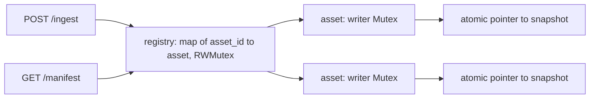

# Architecture

The service keeps every asset's manifest in memory and answers three routes: `POST /ingest`, `GET /manifest/{asset_id}`, and `GET /health`. State resets on restart.

This document records the store design and the alternatives we rejected, so the same comparison does not need to be repeated.

- [Store](#store)
- [Ingest](#ingest)
- [Manifest](#manifest)
- [Wire format](#wire-format)
- [Assumptions](#assumptions)
- [Alternatives considered](#alternatives-considered)
- [Limits and future work](#limits-and-future-work)

## Store



- **Registry.** A `map[string]*asset` guarded by a `sync.RWMutex`. The lock is held only to look up an asset or to insert a new one. That critical section is a map operation, independent of how many segments an asset holds, and it is never held while segment data is read or changed.
- **Asset.** Each asset publishes an immutable snapshot through an `atomic.Pointer`: its segments sorted ascending by index, and the time of the last accepted change. Writers to one asset serialize on that asset's `sync.Mutex`. Readers take no asset lock. Requests for different assets never wait on each other.

The shape, as a sketch:

```go
type Store struct {
	mu     sync.RWMutex
	assets map[string]*asset
}

type asset struct {
	mu      sync.Mutex
	current atomic.Pointer[snapshot]
}

type snapshot struct {
	segments []Segment
	updated  time.Time
}
```

Writers use a mutex, not a compare-and-swap loop. A write reads the current snapshot, builds the next one, and stores it, so writers to one asset must take turns either way. A losing compare-and-swap would discard the next snapshot and build it again.

## Ingest

A segment is identified by `asset_id` plus `segment_index`.

1. Look up the asset under the registry read lock. If it does not exist, take the registry write lock, check again, and insert the asset with a snapshot holding this segment already stored. An asset is never visible without at least one segment.
2. For an existing asset, take the asset's writer lock, load the current snapshot, and binary-search its segments for the index.
3. If the index exists and the incoming `received_at` is not strictly newer than the stored one, the write is a no-op. Nothing changes, including `last_updated`.
4. Otherwise build the next segment slice and store a new snapshot. The caller supplies the clock, and the store reads it inside the writer lock.

Building the next slice never changes an element a reader may still hold:

- A new index past the end is appended, amortised O(1).
- A new index inside the slice is inserted into a copy.
- A newer version of an existing index replaces it in a copy. Replacement never changes the order, because the index is unchanged.

### Ordering

The slice stays sorted by insertion. It is never fully re-sorted. Ordering happens on write rather than on read:

- CDN origins depend on `GET` being fast.
- Sorting on every `GET` repeats work the manifest already needed.
- A cache rebuilt lazily is stale after every write. A live asset is written about as often as it is polled, so nearly every `GET` would sort, and that sort would need the writer lock.
- Inserting on write is a binary search and at most one copy, and that work stays off the read path.

A valid request returns `202 Accepted`. The new snapshot is stored before the response is written, so a `GET` issued after the `202` arrives sees the change.

## Manifest

1. Look up the asset under the registry read lock. A missing asset returns `404`.
2. Load the asset's current snapshot.
3. Build the response and encode JSON with no lock held.

A read never waits on a writer to the same asset. The atomic store and load act as release and acquire, so a reader that loads a snapshot sees everything written before that snapshot was stored.

## Wire format

Store types carry no JSON tags. The HTTP layer owns the request and response types and converts from the store's types. `last_updated` is written as RFC 3339 in UTC, to the second.

## Assumptions

- `received_at` is the time the producer created the segment, not the time it was sent. If the transcoder re-stamps a resend, a stale resend would win under the newer-wins rule.
- A resend with a newer `received_at` is a new entry, even with an identical `cdn_url`. It replaces the stored segment and advances `last_updated`.
- With an equal `received_at` and a different `cdn_url`, the first write wins.
- `last_updated` is the time the store accepted the change, like an `updated_at` column. It is not derived from `received_at`.
- There is no persistence and no eviction. Memory grows with the number of assets and segments.

## Alternatives considered

### Read-write mutex per asset

Each asset would hold its sorted segments and `last_updated` behind a `sync.RWMutex`. Readers would copy the slice header under the read lock and encode after releasing it.

Rejected because:

- A `sync.RWMutex` gives a waiting writer priority. Once a goroutine is waiting in `Lock`, new `RLock` calls block until that writer has acquired and released the lock.
- During a burst of writes to one asset, polls queue behind ingest on the path CDN origins depend on.
- The atomic pointer design keeps the same rule, that published segments are never changed, and adds only the snapshot and one store and load.

### Sharded producer-consumer queue

Ingest would validate, enqueue to a bounded channel chosen by `hash(asset_id)`, and return `202`. One worker per shard would apply events, so all events for an asset reach the same worker. A single global consumer is ruled out because it would serialize unrelated assets.

Rejected because:

- A `GET` after the `202` may not see the change, or may return `404` for an asset's first segment.
- A queue absorbs a short burst but does not raise throughput. Once it is full, ingest must block or reject, and an event that has already received `202` must never be dropped.
- It does not remove synchronization. Readers still need a safe view of what the workers publish.
- Requests waiting on a lock and events waiting in a queue both hold memory, so the queue does not remove the out-of-memory risk. It adds its own buffer to it.

### `sync.Map` for the registry

Every load returns `any` and needs a type assertion. It is tuned for keys written once and read many times, while a backfill creates many assets at once. A plain map with a `sync.RWMutex` is typed and suits this load.

## Limits and future work

Under a large burst, the first limit is memory, because nothing is evicted.

Not built:

- `Content-Length` and an `ETag` derived from a version counter, so a CDN origin polling with `If-None-Match` receives `304` with no body when nothing has changed.
- Retention or eviction of assets and segments.
